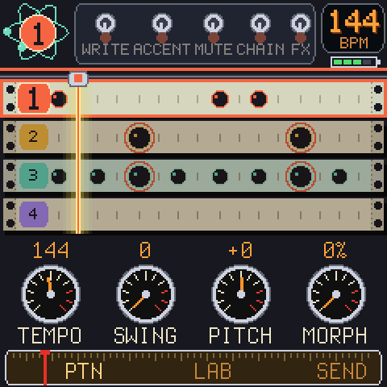
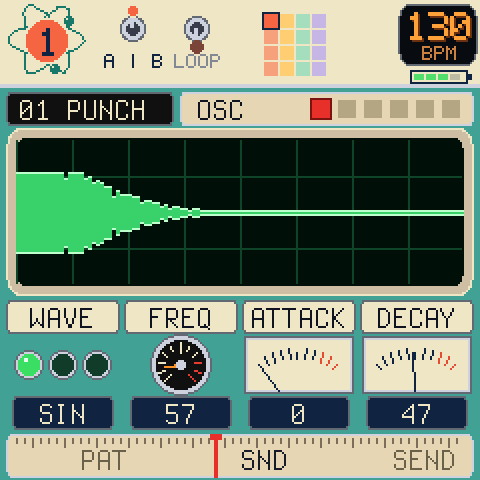
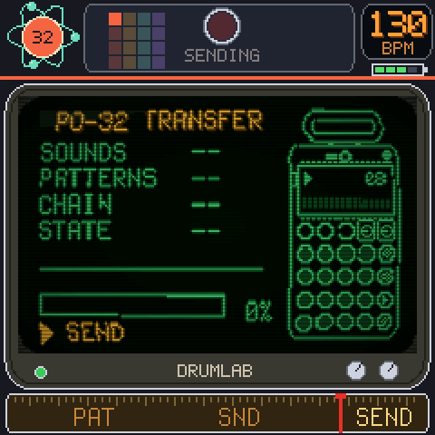
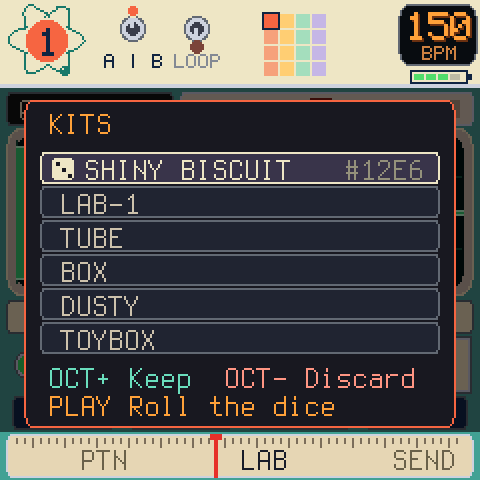
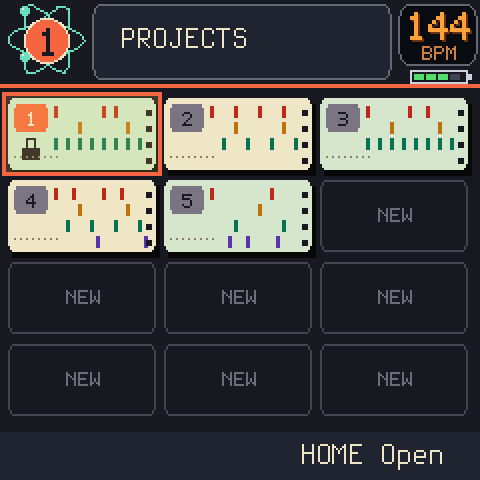
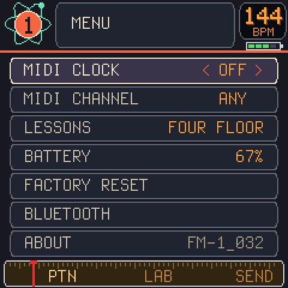

# Drumlab

A drum machine for the FM-1 that works like the PO-32 tonic, and sends its sounds and patterns to one.

  
  

## What is it

16 sounds, 16 patterns, 4 lanes, all the PO-32's tricks, and a screen that looks like a 1950s science lab. Make the beat here, turn the knobs, roll a kit, then plug a cable into a PO-32 and it hears all of it.

No PO-32? It's still a drum machine.

## Links

- [Play online](https://ihavenocluewhatimdoing.com/drumlab/play/)
- [Install](https://ihavenocluewhatimdoing.com/drumlab/install.html)
- [Manual](https://ihavenocluewhatimdoing.com/drumlab/guide/)
- [Tutorials](https://ihavenocluewhatimdoing.com/drumlab/manual/)
- [Cheat sheet](https://ihavenocluewhatimdoing.com/drumlab/cheatsheet/)
- [Projects](https://ihavenocluewhatimdoing.com/drumlab/projects/)

## Controls

| | PATTERN | SOUND | SEND |
| --- | --- | --- | --- |
| `HOME` | next view, hold: projects | same | same |
| `PRESETS` | sound | sound | |
| `SELECT` | pattern | | |
| `ALGORITHM` | | page | |
| `KNOB 1`-`4` | tempo, swing, pitch, morph | the page's four settings | |
| `REC` | tap: WRITE, hold while playing: punch in | | |
| `ENV` / `ARP` / `SEL` | accent / mute, solo / chain | | |
| `FX` | hold: effects, tap: latch | | |
| `EDIT` | hold: clear | hold: fine knobs | |
| `SEL` | | patch A / B | |
| `OCT+` | copy the pattern | kits | yes (in the window) |
| `PLAY` | play / stop | loop the sound | send |
| `GLO` | help | help | help |
| `GLO` + `HOME` | menu | menu | menu |

## The three brothers

[Chipbox](https://github.com/pbarilla/chipbox) (chiptunes), [Smileyface](https://ihavenocluewhatimdoing.com/smileyface/) (acid) and Drumlab. Over Bluetooth one of them leads and the others follow (GLO + HOME, BLUETOOTH): tempo, start and stop, a sidechain from the leader's kicks, patterns, punch-in effects and key. Each can also send and follow the standard MIDI clock over USB (MIDI CLOCK).

## Building the site

`web/build.sh` makes the browser build (Docker). `python3 web/make_images.py LAB SHOTS` redoes every picture from the host simulator, `python3 web/make_samples.py` the sample projects, `python3 web/gen_site.py` the pages. `web/stage_firmware.sh` puts a build on the site for the installer. `node web/test_installer.mjs` and `node web/test_projects.mjs` check the installer and the Projects page against a simulated FM-1.

## Licence

GPL-3.0-only, see `LICENSING.md`. Built on [Chipbox](https://github.com/pbarilla/chipbox), which is built on [Dinghy](https://github.com/zvenson/dinghy), which is built on
[Felucca](https://github.com/hugelton/Felucca) by Leo Kuroshita (Hügelton Instruments) with the changes of
[SLOOP](https://github.com/isod89/sloop-fm1) (isod89). PO-32 and Pocket Operator belong to Teenage Engineering.
